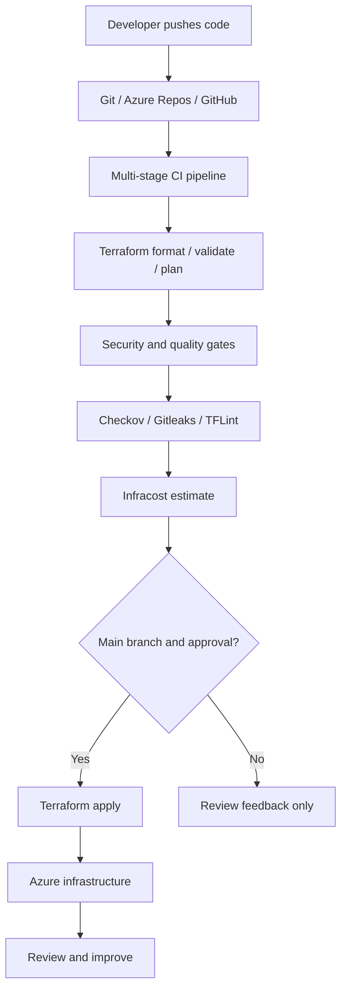

 <!-- ============================================================ -->
<!-- BHASKAR JYOTI DEKA | CLOUD ENGINEERING + DEVSECOPS PROFILE   -->
<!-- Profile: Bhaskar Jyoti Deka | Assam, India -->
<!-- ============================================================ -->

<div align="center">


<a href="https://git.io/typing-svg"></a>

<br />

<a href="https://github.com/bhaskardeka-cloud"></a>
<a href="https://github.com/bhaskardeka-cloud?tab=followers"></a>


<br /><br />

**`☁️ CLOUD`** &nbsp; **`⚙️ AUTOMATION`** &nbsp; **`🔐 SECURITY`** &nbsp; **`🚀 DELIVERY`**

</div>

---

**DevSecOps & Cloud Infrastructure Engineer** · Assam, India

📧 **bjyotideka22@gmail.com** · 📞 **+91 8876280335** · [LinkedIn](https://www.linkedin.com/in/bhaskar-jyoti-deka6/)

## 👨‍💻 About me

```yaml
name: Bhaskar Jyoti Deka
education: B.Tech | Computer Science
focus:
  - Cloud Engineering
  - DevSecOps
  - Infrastructure as Code
cloud_platform: Microsoft Azure
infrastructure: Terraform
ci_cd:
  - Azure DevOps YAML Pipelines
  - GitHub Actions
source_control:
  - Git
  - GitHub
  - Azure Repos
security_and_quality:
  - Checkov
  - Gitleaks
  - TFLint
  - tfsec
cost_visibility: Infracost
operating_system: Linux
mindset: Learn → Build → Automate → Secure → Improve
```

I'm a **Computer Science student** focused on **Cloud Engineering and DevSecOps**. I enjoy turning manual infrastructure tasks into repeatable workflows, designing **multi-stage CI/CD pipelines**, and bringing security and cost checks closer to the development process.

- 🔭 **Building:** Azure infrastructure automation and YAML-based delivery pipelines.
- 🌱 **Learning:** Cloud security, DevSecOps practices, and production-minded automation.
- 🧩 **Interested in:** Infrastructure as Code, CI/CD, Azure networking, and secure delivery.
- 💬 **Let's talk about:** Terraform, Azure, Git, Linux, GitHub Actions, and Azure DevOps.
- 🎯 **Goal:** Grow into a capable Cloud / DevSecOps Engineer through hands-on projects.

---

## 🛠️ Engineering toolbox

<div align="center">

### ☁️ Cloud & infrastructure


### 🔁 Version control & delivery


### 💻 Programming & configuration


<br />


### 🔐 DevSecOps & cost awareness


</div>

---

## 🚀 Featured engineering work

> Project descriptions summarize hands-on areas of work. Add real repository links when each project is published; no demo links are fabricated here.

<table>
<tr>
<td width="50%" valign="top">

### 🔐 Multi-stage DevSecOps pipeline

**Azure DevOps YAML · Terraform · Checkov · Gitleaks · Infracost**

A staged pipeline design connecting infrastructure validation, security checks, cost visibility, and controlled deployment.

**Highlights**
- Branch-aware execution for feature and main branches
- Terraform validation, plan, and controlled apply
- Security scanning in the delivery process
- Cost estimation before infrastructure changes
- Approval-oriented deployment workflow

</td>
<td width="50%" valign="top">

### ☁️ Azure infrastructure automation

**Azure · Terraform · Remote State · Networking**

Infrastructure as Code workflows for repeatable Azure provisioning and state management.

**Highlights**
- Declarative Terraform configurations
- Azure Storage remote backend
- Reusable environment structure
- Authentication and access-control troubleshooting
- Automation through Azure DevOps

</td>
</tr>
<tr>
<td width="50%" valign="top">

### ⚙️ GitHub Actions automation

**GitHub · GitHub Actions · YAML · Git**

Exploring event-driven workflows, source control, and repeatable automation with YAML pipelines.

**Focus areas**
- Repository-based CI workflows
- Trigger and branch configuration
- Jobs, steps, and environment variables
- Workflow diagnostics

</td>
<td width="50%" valign="top">

### 🧪 Security & quality checks

**Checkov · Gitleaks · TFLint · tfsec**

Exploring automated guardrails for infrastructure code and repositories.

**Focus areas**
- IaC security checks
- Secret detection
- Terraform linting
- Early feedback before deployment

</td>
</tr>
</table>

---

## 🧭 How I think about DevSecOps



<div align="center">

**`PLAN` → `SCAN` → `REVIEW COST` → `APPROVE` → `APPLY`**

</div>

> This is a conceptual workflow diagram, not a claim that every gate has been deployed in every repository.

---

## 🧠 Currently strengthening

| Area | What I'm focusing on |
| :--- | :--- |
| **Azure** | Networking, identity, storage, infrastructure operations |
| **Terraform** | Modules, variables, state, backends, environment patterns |
| **Azure DevOps** | Multi-stage YAML, approvals, conditions, service connections |
| **DevSecOps** | Secrets, IaC scanning, shift-left checks |
| **CI/CD** | Branch strategy, validation, deployment safety |
| **Cloud cost** | Understanding infrastructure cost before deployment |

---

## 📊 GitHub analytics

<div align="center">


<br />


</div>

> GitHub stats and graphs are provided by external services; they may occasionally be unavailable or rate-limited.

---

## 🐍 My contribution graph, animated

<div align="center">

<picture>
  <source media="(prefers-color-scheme: dark)" srcset="https://raw.githubusercontent.com/bhaskardeka-cloud/bhaskardeka-cloud/output/github-contribution-grid-snake-dark.svg" />
  <source media="(prefers-color-scheme: light)" srcset="https://raw.githubusercontent.com/bhaskardeka-cloud/bhaskardeka-cloud/output/github-contribution-grid-snake.svg" />
  
</picture>

</div>

> To enable the snake, add `.github/workflows/snake.yml` from the companion ZIP, run it from the Actions tab, and allow the workflow to write to the repository. The image appears only after the `output` branch is created.

---

## 💡 A few engineering principles

```text
$ philosophy --show

[01] Automate repeatable work.
[02] Keep infrastructure version-controlled.
[03] Treat security as part of delivery.
[04] Review cost before deployment.
[05] Learn by building and debugging.
```

---

## 🧭 Cloud & DevSecOps engineering handbook

<details>
<summary><b>Open the hands-on playbook: Azure, Terraform, pipelines, security, cost and troubleshooting</b></summary>

> These are learning notes and reusable examples, not claims of production certifications or employment.

### Azure identity & governance

<details><summary>12 practical checkpoints · Azure identity & governance</summary>

- [ ] Use Microsoft Entra ID for identity.
- [ ] Apply least-privilege RBAC assignments.
- [ ] Scope roles to the smallest resource boundary.
- [ ] Prefer workload identity federation over long-lived secrets.
- [ ] Separate human and automation identities.
- [ ] Review subscription and tenant context.
- [ ] Use managed identities where supported.
- [ ] Protect privileged roles with approval processes.
- [ ] Keep resource tags consistent.
- [ ] Record resource ownership.
- [ ] Avoid hard-coded subscription identifiers.
- [ ] Review audit logs after permission changes.

</details>

### Azure networking

<details><summary>12 practical checkpoints · Azure networking</summary>

- [ ] Plan non-overlapping VNet address spaces.
- [ ] Use subnets by trust boundary.
- [ ] Document NSG inbound rules.
- [ ] Document NSG outbound rules.
- [ ] Minimize public IP exposure.
- [ ] Use private endpoints when appropriate.
- [ ] Understand DNS resolution for private endpoints.
- [ ] Verify effective security rules.
- [ ] Prefer HTTPS for application ingress.
- [ ] Limit management access paths.
- [ ] Review route tables and next hops.
- [ ] Validate connectivity before blaming application code.

</details>

### Azure storage & state

<details><summary>12 practical checkpoints · Azure storage & state</summary>

- [ ] Choose a dedicated Terraform state storage account.
- [ ] Use a private blob container for state.
- [ ] Enable storage security controls.
- [ ] Restrict access to state files.
- [ ] Avoid putting secrets in state.
- [ ] Consider versioning and recovery.
- [ ] Document backend resource group.
- [ ] Document backend storage account.
- [ ] Document backend container.
- [ ] Use unique state keys per environment.
- [ ] Investigate lease locks before breaking them.
- [ ] Never manually edit state without a recovery plan.

</details>

### Terraform design

<details><summary>12 practical checkpoints · Terraform design</summary>

- [ ] Pin Terraform version intentionally.
- [ ] Declare provider requirements.
- [ ] Separate reusable modules from environments.
- [ ] Use typed input variables.
- [ ] Validate variable values.
- [ ] Use locals for repeated expressions.
- [ ] Prefer for_each for stable resource identity.
- [ ] Understand count index changes.
- [ ] Review plan before apply.
- [ ] Keep secrets out of committed tfvars.
- [ ] Format code with terraform fmt.
- [ ] Validate syntax with terraform validate.

</details>

### Terraform operations

<details><summary>12 practical checkpoints · Terraform operations</summary>

- [ ] Run init with the intended backend.
- [ ] Verify selected workspace or environment.
- [ ] Review drift in terraform plan.
- [ ] Store plan artifacts securely.
- [ ] Use explicit approval before apply.
- [ ] Restrict destroy permissions.
- [ ] Understand dependency graph.
- [ ] Avoid unnecessary depends_on.
- [ ] Import existing resources carefully.
- [ ] Check provider upgrade notes.
- [ ] Use lifecycle rules only with a reason.
- [ ] Investigate locked state before force-unlock.

</details>

### Azure DevOps YAML

<details><summary>12 practical checkpoints · Azure DevOps YAML</summary>

- [ ] Separate stages by responsibility.
- [ ] Use readable job and step names.
- [ ] Use variable groups for shared configuration.
- [ ] Use templates to reduce duplication.
- [ ] Scope secrets to authorized pipelines.
- [ ] Trigger plan checks on feature branches.
- [ ] Gate apply on the protected main branch.
- [ ] Require approvals for sensitive environments.
- [ ] Use self-hosted agents only when needed.
- [ ] Update and secure build agents.
- [ ] Review service connection permissions.
- [ ] Keep logs free of secret values.

</details>

### GitHub Actions

<details><summary>12 practical checkpoints · GitHub Actions</summary>

- [ ] Use minimum GITHUB_TOKEN permissions.
- [ ] Pin third-party actions where feasible.
- [ ] Avoid exposing secrets to untrusted pull requests.
- [ ] Use environments for deployment approvals.
- [ ] Cache dependencies thoughtfully.
- [ ] Use concurrency groups for deployments.
- [ ] Publish meaningful workflow summaries.
- [ ] Prefer OIDC for cloud authentication.
- [ ] Separate lint, test and deploy jobs.
- [ ] Make workflows easy to rerun.
- [ ] Handle failed jobs visibly.
- [ ] Keep reusable workflows versioned.

</details>

### DevSecOps scanning

<details><summary>12 practical checkpoints · DevSecOps scanning</summary>

- [ ] Scan source for committed credentials.
- [ ] Run Checkov against Terraform.
- [ ] Use TFLint for Terraform linting.
- [ ] Use tfsec where it fits the workflow.
- [ ] Treat critical findings as blockers when justified.
- [ ] Document accepted risk exceptions.
- [ ] Avoid blindly suppressing scanner rules.
- [ ] Keep scan tools updated.
- [ ] Store reports as CI artifacts.
- [ ] Review false positives carefully.
- [ ] Do not print secret values in logs.
- [ ] Verify remediation with a fresh scan.

</details>

### Cost & reliability

<details><summary>12 practical checkpoints · Cost & reliability</summary>

- [ ] Estimate changes with Infracost.
- [ ] Compare baseline and proposed costs.
- [ ] Understand free versus estimated resources.
- [ ] Tag resources for cost allocation.
- [ ] Remove idle learning resources.
- [ ] Define reasonable alert thresholds.
- [ ] Check regional pricing differences.
- [ ] Design for repeatable deployments.
- [ ] Document rollback procedures.
- [ ] Review platform service limits.
- [ ] Keep a simple incident timeline.
- [ ] Measure improvement after each change.

</details>

### Linux & Git

<details><summary>12 practical checkpoints · Linux & Git</summary>

- [ ] Use pwd and ls to confirm context.
- [ ] Inspect file permissions before chmod.
- [ ] Prefer least privilege with sudo.
- [ ] Check systemd service status.
- [ ] Use journalctl for service logs.
- [ ] Understand environment variables.
- [ ] Review git diff before commit.
- [ ] Keep commits focused.
- [ ] Use branches for isolated changes.
- [ ] Resolve merge conflicts deliberately.
- [ ] Avoid committing .env files.
- [ ] Use .gitignore for generated artifacts.

</details>

### Observability

<details><summary>12 practical checkpoints · Observability</summary>

- [ ] Identify what success looks like.
- [ ] Collect useful application logs.
- [ ] Monitor infrastructure health signals.
- [ ] Track failed pipeline runs.
- [ ] Distinguish errors from warnings.
- [ ] Record deployment timestamps.
- [ ] Document common failure patterns.
- [ ] Use dashboards for important signals.
- [ ] Alert on actionable conditions.
- [ ] Avoid leaking secrets in telemetry.
- [ ] Review incidents for recurring causes.
- [ ] Keep runbooks easy to follow.

</details>

### Collaboration

<details><summary>12 practical checkpoints · Collaboration</summary>

- [ ] Write descriptive pull requests.
- [ ] Explain why a change is needed.
- [ ] Include verification steps.
- [ ] Share relevant plan summaries.
- [ ] Ask for review on risky changes.
- [ ] Keep README setup steps current.
- [ ] Document assumptions clearly.
- [ ] Use issues for trackable work.
- [ ] Communicate deployment impact.
- [ ] Prefer reproducible bug reports.
- [ ] Separate experiments from stable examples.
- [ ] Credit upstream open-source tools.

</details>

## 🧪 Reusable command reference

<details><summary><b>Open CLI command examples</b></summary>

> Examples only. Replace placeholder values and verify your Azure subscription before execution.

### Git essentials

```bash
git status
git branch --show-current
git switch -c feature/readme
git diff --check
git add README.md
git commit -m "docs: improve profile"
git push -u origin feature/readme
```

### Terraform essentials

```bash
terraform version
terraform fmt -recursive
terraform init
terraform validate
terraform plan -out=tfplan
terraform show tfplan
terraform apply tfplan
terraform state list
```

### Azure CLI essentials

```bash
az version
az login
az account list --output table
az account show --output table
az group list --output table
az storage account list --output table
az network vnet list --output table
```

### Linux investigation

```bash
pwd
ls -lah
whoami
uname -a
df -h
free -h
ps aux
ss -tulpn
journalctl -xe
```

### GitHub Actions inspection

```bash
git log --oneline -5
git remote -v
git fetch --prune
git diff main...HEAD --stat
git grep -n "TODO"
git status --short
```

</details>

## 🧱 Pipeline design patterns

<details><summary><b>Expandable CI/CD patterns and security gates</b></summary>

### Pattern 01: Pull request checks

**Goal:** Format, validate, lint, scan and estimate cost without deploying.

**Review questions:**
- What starts this stage?
- What permissions does it need?
- Which artifacts does it produce?
- What should block progression?
- How will a reviewer validate the result?

### Pattern 02: Main branch release

**Goal:** Plan, review, approve and apply from a protected branch.

**Review questions:**
- What starts this stage?
- What permissions does it need?
- Which artifacts does it produce?
- What should block progression?
- How will a reviewer validate the result?

### Pattern 03: State protection

**Goal:** Use remote state, controlled access and safe locking.

**Review questions:**
- What starts this stage?
- What permissions does it need?
- Which artifacts does it produce?
- What should block progression?
- How will a reviewer validate the result?

### Pattern 04: Credential hygiene

**Goal:** Prefer short-lived federated credentials where supported.

**Review questions:**
- What starts this stage?
- What permissions does it need?
- Which artifacts does it produce?
- What should block progression?
- How will a reviewer validate the result?

### Pattern 05: Environment isolation

**Goal:** Keep development and production settings separated.

**Review questions:**
- What starts this stage?
- What permissions does it need?
- Which artifacts does it produce?
- What should block progression?
- How will a reviewer validate the result?

### Pattern 06: Failure transparency

**Goal:** Publish reports and stop deployment on meaningful failures.

**Review questions:**
- What starts this stage?
- What permissions does it need?
- Which artifacts does it produce?
- What should block progression?
- How will a reviewer validate the result?

### Pattern 07: Cost visibility

**Goal:** Compare estimated changes before approving infrastructure.

**Review questions:**
- What starts this stage?
- What permissions does it need?
- Which artifacts does it produce?
- What should block progression?
- How will a reviewer validate the result?

### Pattern 08: Security feedback

**Goal:** Make scan findings visible in the developer workflow.

**Review questions:**
- What starts this stage?
- What permissions does it need?
- Which artifacts does it produce?
- What should block progression?
- How will a reviewer validate the result?

### Pattern 09: Change traceability

**Goal:** Tie deployments to commits, reviews and workflow runs.

**Review questions:**
- What starts this stage?
- What permissions does it need?
- Which artifacts does it produce?
- What should block progression?
- How will a reviewer validate the result?

### Pattern 10: Recovery readiness

**Goal:** Document what to do when apply or deployment fails.

**Review questions:**
- What starts this stage?
- What permissions does it need?
- Which artifacts does it produce?
- What should block progression?
- How will a reviewer validate the result?

</details>

## 🗂️ Infrastructure review templates

<details><summary><b>Expandable pull request and release templates</b></summary>

### Infrastructure pull request

```text
01. What resources will be added or removed?
02. Was terraform fmt executed?
03. Did terraform validate pass?
04. Was the plan reviewed?
05. Were security scan findings checked?
06. Was cost impact reviewed?
07. Are secrets excluded from the diff?
08. Is rollback documented?
```

### Pipeline change

```text
01. Which branches trigger the pipeline?
02. Does a feature branch ever apply?
03. Are approvals correctly scoped?
04. Which identity accesses Azure?
05. Are tool versions pinned?
06. Are secrets masked?
07. Does failure stop the release?
08. Are logs and artifacts retained?
```

### Incident note

```text
01. What failed?
02. When did it start?
03. Which environment was affected?
04. What changed immediately beforehand?
05. What logs support the diagnosis?
06. What was the safe mitigation?
07. How was recovery verified?
08. What preventive action is proposed?
```

### Learning lab

```text
01. What was the objective?
02. Which tools were used?
03. What assumptions were made?
04. What commands were run?
05. What output was expected?
06. What actually happened?
07. How was the issue resolved?
08. What would be improved next time?
```

</details>

## 📚 Engineering glossary

<details><summary><b>Open compact explanations of important concepts</b></summary>

- **IaC:** Managing infrastructure through version-controlled configuration.
- **Idempotence:** Repeated operations aim for the same desired result.
- **Drift:** Actual resources differ from the declared configuration.
- **Plan:** A preview of proposed infrastructure changes.
- **Apply:** Execution of approved infrastructure changes.
- **State:** Terraform mapping between configuration and managed objects.
- **Backend:** Where Terraform state is stored and accessed.
- **Lease:** A lock mechanism that helps prevent concurrent state writes.
- **Provider:** Plugin that connects Terraform to a service API.
- **Module:** Reusable package of Terraform configuration.
- **Variable:** Input parameter used to customize configuration.
- **Local:** Named expression evaluated within Terraform.
- **Output:** Value exposed from a Terraform module.
- **for_each:** Create instances keyed by stable identifiers.
- **count:** Create indexed resource instances.
- **RBAC:** Role-based access control for scoped permissions.
- **OIDC:** Federated identity protocol often used for short-lived authentication.
- **Service connection:** Azure DevOps configuration connecting pipelines to external services.
- **Agent:** Worker that executes CI/CD jobs.
- **Artifact:** Saved output produced by a pipeline job.
- **Stage:** Logical grouping of pipeline jobs.
- **Job:** Collection of steps running on an agent.
- **Step:** Individual task or script inside a job.
- **Approval:** Human or policy gate before a protected operation.
- **Branch protection:** Repository controls applied to sensitive branches.
- **Pull request:** Proposed code change reviewed before merging.
- **Gitleaks:** Tool for finding possible credentials in code.
- **Checkov:** Policy and misconfiguration scanning for infrastructure code.
- **TFLint:** Terraform-focused linting and quality checks.
- **Infracost:** Infrastructure cost estimation from IaC changes.
- **NSG:** Azure network security group for traffic filtering.
- **VNet:** Azure virtual network boundary.
- **Subnet:** Segment of a virtual network.
- **Private endpoint:** Private network access to a supported Azure service.
- **Managed identity:** Azure-managed identity for supported workloads.
- **Secret rotation:** Replacing credentials on a planned or urgent basis.
- **Least privilege:** Granting only permissions required for a task.
- **Observability:** Understanding systems through logs, metrics and traces.
- **Rollback:** Returning to a known safer version or configuration.

</details>

## 🧩 Troubleshooting decision notes

<details><summary><b>Open common diagnosis paths</b></summary>

### Terraform init fails

1. Confirm backend resource names.
2. Verify the active Azure identity.
3. Check storage permissions and network access.
4. Read the first meaningful error before retrying.

### Terraform plan is locked

1. Check whether another run is active.
2. Inspect the remote lease carefully.
3. Wait for legitimate operations to finish.
4. Only unlock after confirming no active writer.

### Pipeline cannot find a template

1. Check repository and branch.
2. Check relative template path.
3. Verify filename capitalization.
4. Confirm the file is committed and accessible.

### Scanner command not found

1. Verify installation on the selected agent.
2. Check PATH in the actual job context.
3. Print the tool version in a diagnostic step.
4. Restart a self-hosted agent after environment changes when necessary.

### Apply runs on a feature branch

1. Review branch conditions.
2. Review dependencies between stages.
3. Inspect approvals and environment settings.
4. Test with a harmless change before trusting the gate.

### Infracost shows unexpected zero

1. Verify working directory.
2. Confirm Terraform configuration was discovered.
3. Check credentials and project detection.
4. Compare local and pipeline command arguments.

### Azure authorization fails

1. Confirm tenant and subscription.
2. Check the service principal or federated identity.
3. Inspect RBAC scope.
4. Wait for role propagation and retry appropriately.

### GitHub snake is missing

1. Run the snake workflow manually.
2. Check Actions logs for failures.
3. Verify output branch was published.
4. Confirm README image URLs point to the correct branch.

</details>

## 🛤️ Learning roadmap

<details><summary><b>Open the practical growth roadmap</b></summary>

### Foundation

- [ ] Practice **Linux shell navigation** with a small reproducible lab.
- [ ] Practice **Git branching and merges** with a small reproducible lab.
- [ ] Practice **YAML fundamentals** with a small reproducible lab.
- [ ] Practice **Networking basics** with a small reproducible lab.
- [ ] Practice **Cloud shared responsibility** with a small reproducible lab.

### Azure infrastructure

- [ ] Practice **Resource groups and subscriptions** with a small reproducible lab.
- [ ] Practice **VNets and subnets** with a small reproducible lab.
- [ ] Practice **Storage accounts** with a small reproducible lab.
- [ ] Practice **Identity and RBAC** with a small reproducible lab.
- [ ] Practice **Monitoring fundamentals** with a small reproducible lab.

### Terraform workflows

- [ ] Practice **Variables and outputs** with a small reproducible lab.
- [ ] Practice **Modules and providers** with a small reproducible lab.
- [ ] Practice **Remote backend and state** with a small reproducible lab.
- [ ] Practice **Plan review and approval** with a small reproducible lab.
- [ ] Practice **Drift and import workflows** with a small reproducible lab.

### CI/CD automation

- [ ] Practice **Multi-stage YAML pipelines** with a small reproducible lab.
- [ ] Practice **Branch-aware conditions** with a small reproducible lab.
- [ ] Practice **Artifacts and dependencies** with a small reproducible lab.
- [ ] Practice **Service connections and OIDC** with a small reproducible lab.
- [ ] Practice **Environment approvals** with a small reproducible lab.

### DevSecOps controls

- [ ] Practice **Secret scanning** with a small reproducible lab.
- [ ] Practice **IaC policy checks** with a small reproducible lab.
- [ ] Practice **Linting and validation** with a small reproducible lab.
- [ ] Practice **Cost estimation** with a small reproducible lab.
- [ ] Practice **Risk-based exception handling** with a small reproducible lab.

### Engineering maturity

- [ ] Practice **Documentation** with a small reproducible lab.
- [ ] Practice **Observability** with a small reproducible lab.
- [ ] Practice **Incident response** with a small reproducible lab.
- [ ] Practice **Change review** with a small reproducible lab.
- [ ] Practice **Continuous improvement** with a small reproducible lab.

</details>

## 📌 Profile notes

- This profile highlights hands-on learning and personal engineering projects.
- Linked badges and statistics are rendered by external services and may be temporarily unavailable.
- Featured project links should be updated as public repositories become available.
- Public contact information was provided for this profile; remove the phone badge if you prefer email-only contact.

---


<details><summary><b>More practical engineering review prompts</b></summary>

- **Release readiness 1:** Confirm the intended environment and approval boundary.
- **Release readiness 2:** Confirm the intended environment and approval boundary.
- **Identity review 001:** What is the intended outcome?
- **Identity review 002:** What is the smallest required permission?
- **Identity review 003:** Which configuration is the source of truth?
- **Identity review 004:** What evidence confirms the change?
- **Identity review 005:** Which failure would block deployment?
- **Identity review 006:** What should be logged without exposing secrets?
- **Identity review 007:** How is the change safely reverted?
- **Identity review 008:** What should the reviewer verify?
- **Identity review 009:** Which assumptions need documentation?
- **Identity review 010:** How is the result tested independently?
- **Network review 011:** What is the intended outcome?
- **Network review 012:** What is the smallest required permission?
- **Network review 013:** Which configuration is the source of truth?
- **Network review 014:** What evidence confirms the change?
- **Network review 015:** Which failure would block deployment?
- **Network review 016:** What should be logged without exposing secrets?
- **Network review 017:** How is the change safely reverted?
- **Network review 018:** What should the reviewer verify?
- **Network review 019:** Which assumptions need documentation?
- **Network review 020:** How is the result tested independently?
- **State review 021:** What is the intended outcome?
- **State review 022:** What is the smallest required permission?
- **State review 023:** Which configuration is the source of truth?
- **State review 024:** What evidence confirms the change?
- **State review 025:** Which failure would block deployment?
- **State review 026:** What should be logged without exposing secrets?
- **State review 027:** How is the change safely reverted?
- **State review 028:** What should the reviewer verify?
- **State review 029:** Which assumptions need documentation?
- **State review 030:** How is the result tested independently?
- **Pipeline review 031:** What is the intended outcome?
- **Pipeline review 032:** What is the smallest required permission?
- **Pipeline review 033:** Which configuration is the source of truth?
- **Pipeline review 034:** What evidence confirms the change?
- **Pipeline review 035:** Which failure would block deployment?
- **Pipeline review 036:** What should be logged without exposing secrets?
- **Pipeline review 037:** How is the change safely reverted?
- **Pipeline review 038:** What should the reviewer verify?
- **Pipeline review 039:** Which assumptions need documentation?
- **Pipeline review 040:** How is the result tested independently?
- **Security review 041:** What is the intended outcome?
- **Security review 042:** What is the smallest required permission?
- **Security review 043:** Which configuration is the source of truth?
- **Security review 044:** What evidence confirms the change?
- **Security review 045:** Which failure would block deployment?
- **Security review 046:** What should be logged without exposing secrets?
- **Security review 047:** How is the change safely reverted?
- **Security review 048:** What should the reviewer verify?
- **Security review 049:** Which assumptions need documentation?
- **Security review 050:** How is the result tested independently?
- **Cost review 051:** What is the intended outcome?
- **Cost review 052:** What is the smallest required permission?
- **Cost review 053:** Which configuration is the source of truth?
- **Cost review 054:** What evidence confirms the change?
- **Cost review 055:** Which failure would block deployment?
- **Cost review 056:** What should be logged without exposing secrets?
- **Cost review 057:** How is the change safely reverted?
- **Cost review 058:** What should the reviewer verify?
- **Cost review 059:** Which assumptions need documentation?
- **Cost review 060:** How is the result tested independently?
</details>

## 🤝 Let's connect

<div align="center">

<a href="https://github.com/bhaskardeka-cloud"></a>

<a href="https://www.linkedin.com/in/bhaskar-jyoti-deka6/"></a>

<a href="mailto:bjyotideka22@gmail.com"></a>
<a href="tel:+918876280335"></a>

<br /><br />

**Open to connecting with people interested in Azure, Cloud Engineering, DevSecOps, and infrastructure automation.**

### `Build thoughtfully. Automate reliably. Secure continuously.`


</div>
